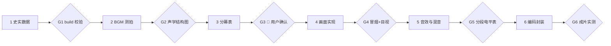

# 01 · 六阶段流水线与验收关卡（Gate）

> 每个阶段结束都有一个 Gate。**Gate 不过不进下一阶段。** 标 🧑 的 Gate 需要用户确认。
> 参考实现：`reference/huangchao/`（最新、已验收）；`reference/anshi/`（外部短片嵌合、多段拼接）。

> 与旧版的区别：**BGM 测拍提前到第 2 阶段**、新增**分幕表用户确认**。旧流程把节拍提取放在画面之后，导致画面做完才发现和音乐结构对不上，需要整版返工。

---

## 阶段 1 · 史实考据与结构化数据

**做什么**
- 模块化数据：`data_geo.py`（阵营配色、城池/关隘/渡口坐标、`init_faction`）、`data_routes.py`（行军路线 waypoints）、`data_timeline.py`（事件、`city_control` 变更）、可选 `data_units.py` / `data_battles.py`。
- 日期统一换算为 ISO 8601，并标 `date_precision`（`day` / `day_approx` / `month` / `approx`）与 `coord_confidence`（`high` / `medium` / `low`）。
- 流动作战：在每个事件里同时写**占领**与**收复**（见 `00_rules.md` B2）。

**产物**：`data/<project>_wargame.json`（含逐事件 `city_control` 快照）、`data/<project>_routes.geojson`。

**G1**：`python src/build.py` 必须通过，至少校验：ID 唯一、经纬度在视口内、引用完整、时间有序、每次控制权变更前后确实不同。并**打印每个事件的攻方城池列表**，人工扫一眼有没有“大军已走、地盘还在”的残留。

> 黄巢版输出示例：`校验通过！跨度 3528 天 | 城池/渡口 31 座 | 大迂回路线 5 段（累计 6275.0 km） | 时间轴 16 帧 | 控制权变更 66 次`

---

## 阶段 2 · BGM 测拍与声学结构

**做什么**（详见 `04_audio.md` §1）
1. FFmpeg 把 BGM 转为 `48000 Hz` 立体声 WAV。
2. librosa：`beat_track` → BPM / `beats`；`onset_strength` + `onset_detect` → `strong_onsets`；逐秒 RMS；30–140 Hz Bass 能量。
3. 标出 Intro / Build / 抽空 / Drop / Breakdown / Outro 的**实测**起止秒数。

**G2**：输出 `*_beat_map.png`（波形 + beats + 段落色块）和结构表，段落边界与听感一致。

---

## 阶段 3 · 分幕表（storyboard）

**做什么**：把史实事件贴到音乐结构上，每幕一行：

| 字段 | 说明 |
| :-- | :-- |
| `id` / `mode` | 如 `T05` / `macro`、`B_GZ` / `tactical`、`T13` / `cutscene` |
| `t0` / `t1` | 必须落在实测 beat 上 |
| 史实节点 | 日期 + 事件 |
| 双方 | 我方算子/帅旗、敌方算子/帅旗 |
| 版图变化 | 本幕占领哪些、收复哪些 |
| 关键 SFX | 在哪几拍放什么 |
| `bgm` 电平 | 该段包络值 |

**产物**：`output/audio/<project>_beat_map.json` 中的 `acts` 数组 —— 它是**全工程唯一的时间来源**，渲染器与混音脚本都只读它。

**G3 🧑**：把分幕表发给用户确认。同时自检：时长配比符合 `00_rules.md` A1；Drop 上有战役，Breakdown 上没有主攻城。

---

## 阶段 4 · 画面实现

| 子系统 | 参考代码（`reference/huangchao/src/`） |
| :-- | :-- |
| 宏观地形 + 势力场 | `hc_terrain.py`：`build_relief_terrain`、`compute_smoothed_faction_scores`、`compose_macro_from_scores` |
| 宏观每幕导演脚本 | `hc_campaign_renderer.py`：`HuangChaoCampaignEngine.__init__` 里的 `act_specs`（`ctrl_prev/ctrl_cur/arrow/banners/units`） |
| 三段前锋场预计算 | 同上 `__init__` 末尾 `act_scores`（`s0, s_mid, s1`） |
| 宏观帧绘制 | `_draw_macro`（96 档背景缓存、城池翻色、箭头、算子、标签） |
| 剧情剧场 | `_draw_cutscene`（T01 / T12 / T13 / T14_LK / T16） |
| 战术沙盘 | `hc_tactical.py`：`Actor`、`_build_actors_*`、`_render_scene`、`render` |
| 兵种 / 建筑 / 帅旗 | `sprites.py`、`landmarks.py` |
| 主角 / 名将像素精灵 | `huangchao_sprites_ultra.py`（主角 5 阶段 × 4 帧）、`tang_warlords_sprites_128.py`（朱温 / 李克用各 4 帧） |

**战术沙盘图层顺序**（不可打乱）：`地形/河/城墙 → 尸体 → 阴影/扬尘 → 士兵与帅旗 → 刀光/血花/箭雨/火烟 → 战术箭头 → 地名与 HUD`。所有随机粒子绑定固定种子。

**G4**（必须在全片编码前完成）
1. **全幕冒烟**：遍历 `acts`，每幕 `u ∈ {0.15, 0.55, 0.92}` 调一次 `render_at`，零异常。黄巢版靠这一步拦下了 `KeyError: ('QI', 'militia', True)`，否则会在渲染 8 分钟中途崩掉。
2. **关键帧目视**：每种模式至少 1 张、每场沙盘 1 张、每个人物剧场 1 张，存 PNG 后**真的打开看**。检查项见 `06_acceptance_checklist.md` §G4。

工具：`tools/qa_tools.py smoke` / 参考 `05_case_huangchao.md` §4 的脚本。

---

## 阶段 5 · 音效合成与混音

见 `04_audio.md` §2–§4。产物：`*_sfx_all.wav`、`*_bgm_ducked.wav`、`*_master_mix.wav`、`*_mix_timeline.png`（四合一诊断图）。

**G5**：脚本打印逐幕 `SFX dB / BGM dB / Mix dB / SFX−BGM`，全部在 `00_rules.md` D4 范围内；母带 LUFS 在 −13.0 ~ −12.9。

---

## 阶段 6 · 编码封装

1. Pillow 渲染 RGB bytes → `ffmpeg -f rawvideo -pix_fmt rgb24 -s 1920x1080 -r 30 -i -` → `libx264 -crf 17 -pix_fmt yuv420p`（不落盘逐帧 PNG）。
2. `-c:v copy` + 母带 WAV 转 `aac 256k 48000 Hz` 封装，`-movflags +faststart`。
3. 只改音频时**不要重渲视频**：重跑混音 → 用已有的无声视频流 `-c:v copy` 重新封装（黄巢版调 LUFS 时省掉了约 8 分钟重渲）。

**G6**：
- `ffmpeg -i` 核对时长、分辨率、帧率、两条流；
- `ebur128` 实测**成片** LUFS / True Peak；
- 从成片抽 3 ~ 4 帧（每种模式各 1）目视。

命令见 `tools/qa_tools.py`。

---

## 多段 / 外部短片（安史版经验，按需）

- 外部 AI 短片：FFmpeg `fps=30,scale=1920:1080:flags=lanczos,setsar=1` 解码成精确帧数，音频进独立 `clip_bus`，并参与侧链触发（`reference/anshi/src/render_part2_amazon_clip.py::_load_external_clip`）。
- 分段成片要保存 stems（`sfx_all` / `bgm_ducked`），拼接处用 0.45 ~ 0.5 s crossfade；合集版从下半第一个非重复事件切入，避免同一段剧情播两次（`render_xiaban_chaikovsky_clip.py`）。
