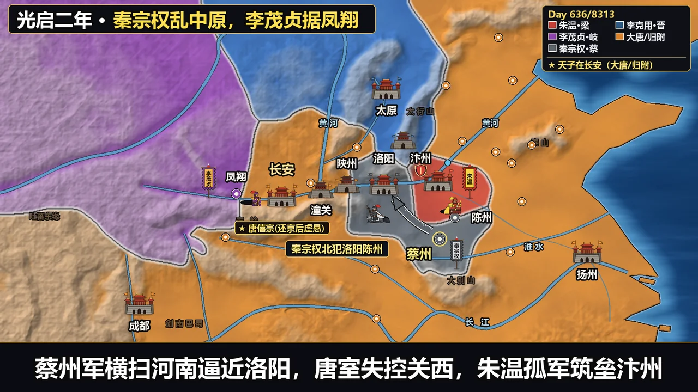

# 08 · 实战案例复盘：《大唐的终结》第二版

《大唐的终结》第二版沿用 18 幕与实测配乐拍点，补齐宫廷剧情、战斗演出和城池易手提示。最终一轮更换弓手精灵，用户复核成片后验收通过。

## 一、把需要观众看见的剧情放进场景

- 开场用独立殿景承载剧情。低分辨率像素画布以最近邻放大，保留像素边缘。缓慢推镜、摇摆的灯笼和余烬为开场提供连续动作，剧情阶段仍由实测配乐拍点驱动。本片开场抽查 40 帧，39 对相邻样帧均有变化。
- 受禅同样使用独立殿景。按拍点推进朝见礼仪，在称号变更阶段切换国号。做分镜时先写清观众要看见的动作，再为该动作选场景和切换时刻。
- 字幕同时出现多地事件时写清先后。本片在已定稿的 T10 补陕州城名，字幕写明「春取陕州、秋降青州」，保留原分幕和拍点。

## 二、让战斗动作、角色精灵与音效共用数据

- 用同一组事件时间驱动放箭、命中反应、扬尘和对应音效。光化战斗用三个命中拍点组织画面和声音，改节奏时只需在一处调整对应事件。
- 同阵营、同编制的兵种复用基础精灵绘制函数。弓手沿用步兵的头盔、护甲和阵营配色，武器与姿态由绘制参数决定。绘制函数随精灵返回弓口锚点，箭矢起点跟随实际图像位置。
- 对容易遮住角色的高亮特效，在全尺寸抽帧检查轮廓。本片用渐细的弯月弧表现挥砍，使角色动作在剪影里仍然清楚。

## 三、在时间轴中明确每次城池易手

按城池记录旧归属、新归属和发生时间，渲染时为每次易手统一生成提示。相邻城池的提示放在不同方位，减轻重叠。验收时核对时间轴记录与实际绘制次数，并按阵营核查覆盖范围。本片共绘制 27 次易手提示，其中 8 次的交接双方均属朱温、李克用以外的势力。

## 四、用同一时间点验证局部换稿的影响

1. 保留换稿前的成片。用渲染器实际使用的分幕逻辑计算受影响帧区间，确定要变化的镜头和用于对照的其他镜头。
2. 在修改区内外分别抽取同一时间点，比对画面差异，并检查差异是否集中在目标角色的站位。本片涉及光化和凤翔两段，共 569 帧。两段抽样均检出画面变化，另抽查 11 个战斗换稿范围外的对照帧，未发现异常。
3. 若换稿只涉及画面，复核成片音轨。比较 AAC 压缩流与比较解码后的 PCM 是两种检查，分别用相同口径对比前后版本。本片两种口径下的新旧哈希分别一致。
4. 对最终交付文件做全流解码并实测响度。本片终版为 2 分 20.31 秒、4,209 帧、1080p / 30 fps，音轨为 AAC 48 kHz 双声道。全流解码退出码为 0，实测响度为 −12.8 LUFS，真峰值为 −1.8 dBTP。新项目的验收阈值见 [G1–G6 验收清单](06_acceptance_checklist.md)。

## 五、让路线、据点和防守各有标记

后续地图分镜先确定本幕的主题人物与势力，再按画面实际交代的行动选择标记。主要路线用更粗的势力色箭头和文字说明，其他势力的实际进攻用常规线宽。画面只交代新势力登场时，用城点、势力色和帅旗定位。画面只交代城池归属变化时，用城点变色和字幕交代。进攻箭头只用于本幕实际发生的推进，防守则在据守点旁放同阵营颜色的盾牌。

**例 · 光启二年，秦宗权乱中原。** 以上样图沿用终版 00:21.20 的地形、势力配色、帅旗和字幕。秦宗权北攻是本幕主线，粗箭头与骑兵错开。李茂贞据凤翔以紫色城点与帅旗标示，后续绘制时把驻军放在城旁。朱温在汴州筑垒，以红色盾牌标示防守。

**后续 · 凤翔围城。** 朱温西进或合围用红色路线，李茂贞守城用凤翔城旁的紫色盾牌，昭宗所在仍用金星。这三种标记分别对应进攻、防守和人物位置。
